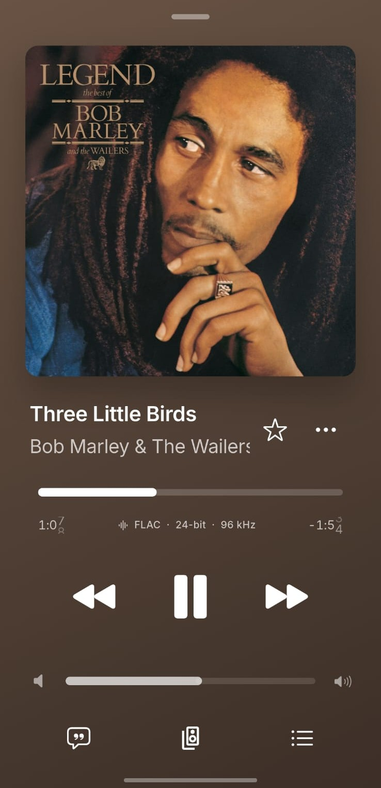
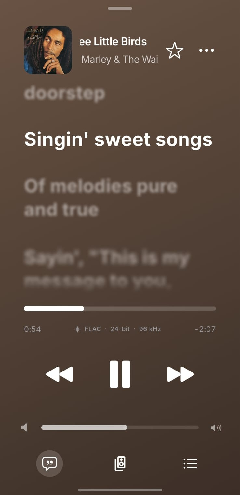

<div align="center">
  
  <h1>Mosix</h1>
  <p>A music player built for your library, your playback flow, and the services you use.</p>
  <p><strong>Flutter · Rust · Android · iOS</strong></p>
</div>

## A closer look

<table>
  <tr>
    <td align="center"><strong>Your music</strong></td>
    <td align="center"><strong>Lyrics in sync with playback</strong></td>
  </tr>
  <tr>
    <td></td>
    <td></td>
  </tr>
</table>

## What Mosix can do

- Find music with installed extensions and choose preferred providers.
- Play local audio, manage queues and playlists, and view lyrics.
- Download tracks, albums, and playlists with configurable quality and metadata.
- Organize a local library, edit tags and artwork, and review download history.
- Connect extension repositories or import extension packages.
- Browse network storage and select Android download folders through the system picker.
- Use light or dark themes and multiple languages.

## Extensions

Add the official extension repository in Mosix:

```text
https://raw.githubusercontent.com/ZuanCrisp/Mosix-Extension/main/registry.json
```

Mosix checks extension requirements against its current app version and runtime features. The official extension repository is aligned with Mosix **1.0.0**.

## Version

**Mosix 1.0.0** · Android package: `com.zuancrisp.mosix`

## Build Android APK

Requirements: Flutter SDK, Android SDK/NDK, Rust toolchain, and Android Rust targets.

```sh
flutter pub get
MOSIX_RUST_ANDROID_ABIS=arm64-v8a MOSIX_DISCORD_SDK=0 ./scripts/build_android.sh --lite
```

Release APKs are written under `build/app/outputs/flutter-apk/`.

## Project layout

- `lib/` — Flutter application
- `rust_backend/` — Rust backend and provider integrations
- `android/`, `ios/` — native platform bridges
- `assets/readme/` — screenshots used in this README
- `third_party/` — bundled Flutter plugins and their required notices

## Maintainer

**ZuanCrisp**

## License

Mosix is distributed under the MIT License. See [LICENSE](LICENSE). Third-party components retain their respective licenses and notices.
