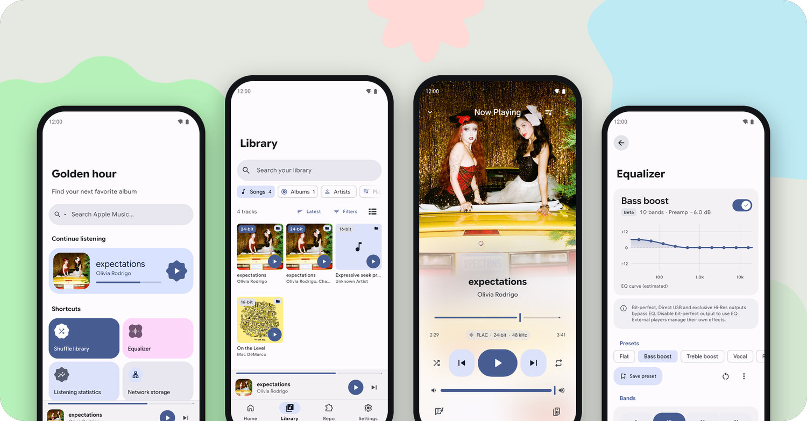

<div align="center">

<picture>
  <source media="(prefers-color-scheme: dark)" srcset="assets/brand/logo/svg/mornye-lockup-horizontal-dark.svg">
  <source media="(prefers-color-scheme: light)" srcset="assets/brand/logo/svg/mornye-lockup-horizontal-light.svg">
  
</picture>

<p align="center">
  <a href="https://trendshift.io/repositories/25971" target="_blank">
    
  </a>
  <a href="https://fmhy.net/mobile#android-audio" target="_blank">
    
  </a>
</p>

</div>

<p align="center">
  <a href="https://github.com/mornyeapp/Mornye/releases/latest">
    <picture>
      <source media="(prefers-color-scheme: dark)" srcset="assets/readme/badges/badge-release-dark.svg">
      
    </picture>
  </a>
  <a href="https://crowdin.com/project/mornye">
    <picture>
      <source media="(prefers-color-scheme: dark)" srcset="assets/readme/badges/badge-crowdin-dark.svg">
      
    </picture>
  </a>
</p>

<p align="center">
  <a href="https://t.me/mornyeupdates">
    <picture>
      <source media="(prefers-color-scheme: dark)" srcset="assets/readme/badges/badge-telegram-channel-dark.svg">
      
    </picture>
  </a>
  <a href="https://t.me/mornyecommunity">
    <picture>
      <source media="(prefers-color-scheme: dark)" srcset="assets/readme/badges/badge-telegram-community-dark.svg">
      
    </picture>
  </a>
</p>

## <picture><source media="(prefers-color-scheme: dark)" srcset="assets/readme/sections/section-screenshots-dark.svg"></picture> Screenshots

<picture>
  <source media="(prefers-color-scheme: dark)" srcset="assets/readme/showcase-dark.png">
  
</picture>

---

## <picture><source media="(prefers-color-scheme: dark)" srcset="assets/readme/sections/section-features-dark.svg"></picture> Features

<table>
  <tr>
    <td width="50%" valign="top">
      <p>
        <picture>
          <source media="(prefers-color-scheme: dark)" srcset="assets/readme/features/feature-player-dark.svg">
          
        </picture>
        <br><b>Built-in player</b>
      </p>
      <p>
        Full-screen cover art, a detailed audio quality label, queue
        controls and a sleep timer. AutoMix blends tracks with its own beat
        detection, and home screen widgets on Android and iOS follow your
        wallpaper colors.
      </p>
      <p></p>
    </td>
    <td width="50%" valign="top">
      <p>
        <picture>
          <source media="(prefers-color-scheme: dark)" srcset="assets/readme/features/feature-hires-dark.svg">
          
        </picture>
        <br><b>Hi-res output</b>
      </p>
      <p>
        USB bit-perfect playback on Android 14 and later, AAudio exclusive
        mode for DAPs at each track's original rate, and a direct USB driver
        with native DSD on compatible DACs.
      </p>
      <p></p>
    </td>
  </tr>
  <tr>
    <td width="50%" valign="top">
      <p>
        <picture>
          <source media="(prefers-color-scheme: dark)" srcset="assets/readme/features/feature-equalizer-dark.svg">
          
        </picture>
        <br><b>Equalizer and loudness</b>
      </p>
      <p>
        A multiband equalizer with presets (beta), volume normalization, and
        ReplayGain scanning based on EBU R128 for single tracks or whole
        selections.
      </p>
      <p></p>
    </td>
    <td width="50%" valign="top">
      <p>
        <picture>
          <source media="(prefers-color-scheme: dark)" srcset="assets/readme/features/feature-lyrics-dark.svg">
          
        </picture>
        <br><b>Lyrics</b>
      </p>
      <p>
        Synced lyrics with word-by-word timing, optional translation and
        romanization lines, and a reorderable chain of lyrics providers,
        including Zarz-LRC. Files without lyrics can search
        online from the player. Pick up to five lines and share them as a card.
      </p>
      <p></p>
    </td>
  </tr>
  <tr>
    <td width="50%" valign="top">
      <p>
        <picture>
          <source media="(prefers-color-scheme: dark)" srcset="assets/readme/features/feature-library-dark.svg">
          
        </picture>
        <br><b>Local library</b>
      </p>
      <p>
        Scan your music folders and browse songs, albums, artists and
        playlists. Review duplicates, edit metadata and export collections
        as M3U8.
      </p>
      <p></p>
    </td>
    <td width="50%" valign="top">
      <p>
        <picture>
          <source media="(prefers-color-scheme: dark)" srcset="assets/readme/features/feature-network-dark.svg">
          
        </picture>
        <br><b>Network storage</b>
      </p>
      <p>
        Play music from SMB, WebDAV, HTTP / HTTPS and Subsonic / OpenSubsonic servers. HTTPS
        connections can trust a single approved certificate fingerprint.
      </p>
      <p></p>
    </td>
  </tr>
  <tr>
    <td width="50%" valign="top">
      <p>
        <picture>
          <source media="(prefers-color-scheme: dark)" srcset="assets/readme/features/feature-foryou-dark.svg">
          
        </picture>
        <br><b>Made for you</b>
      </p>
      <p>
        Rewind recaps your listening, personalized autoplay learns on your
        device, music haptics let you feel the beat, and artist pages show
        upcoming concerts.
      </p>
      <p></p>
    </td>
    <td width="50%" valign="top">
      <p>
        <picture>
          <source media="(prefers-color-scheme: dark)" srcset="assets/readme/features/feature-look-dark.svg">
          
        </picture>
        <br><b>Your look</b>
      </p>
      <p>
        Material 3 Expressive or the Mornye theme, Dynamic Color, an AMOLED
        mode, Material Symbols and layouts for tablets and large screens.
      </p>
      <p></p>
    </td>
  </tr>
  <tr>
    <td width="50%" valign="top">
      <p>
        <picture>
          <source media="(prefers-color-scheme: dark)" srcset="assets/readme/features/feature-extensions-dark.svg">
          
        </picture>
        <br><b>Extensions</b>
      </p>
      <p>
        Add metadata and lyrics sources from community extension
        repositories, then choose their priority. Building one? See the
        <a href="https://mornye.com/docs">extension documentation</a>.
      </p>
      <p></p>
    </td>
    <td width="50%" valign="top">
      <p>
        <picture>
          <source media="(prefers-color-scheme: dark)" srcset="assets/readme/features/feature-keep-dark.svg">
          
        </picture>
        <br><b>Yours to keep</b>
      </p>
      <p>
        Back up and restore settings, history and playlists. The app is open
        source, available in 20 languages, and offers an AltStore / SideStore
        source on iOS.
      </p>
      <p></p>
    </td>
  </tr>
</table>

---

## <picture><source media="(prefers-color-scheme: dark)" srcset="assets/readme/sections/section-development-dark.svg"></picture> Development

Mornye combines a Flutter/Dart UI, a Rust backend from
[`rust_backend/`](rust_backend/), and thin Android/iOS platform bridges.

See the [Contributing Guide](CONTRIBUTING.md) for setup, Android and iOS builds,
Full/Lite variants, crash symbols, validation, and pull request guidelines.

---

## <picture><source media="(prefers-color-scheme: dark)" srcset="assets/readme/sections/section-faq-dark.svg"></picture> FAQ

<details>
<summary><b>Why does the Repo tab ask me to enter a URL?</b></summary>
<br>

Mornye uses a decentralized extension repository system.
Extensions are hosted independently rather than on a built-in server, so
anyone can create and host a compatible repository. In the **Repo** tab, tap
**Add Repository** and enter a GitHub repository URL that contains a
`registry.json` file to browse and install its extensions.

</details>

<details>
<summary><b>Why is my download failing with "Song not found"?</b></summary>
<br>

The track may not be available from your enabled providers. Under
**Settings > Extensions > Provider Priority**, reorder providers and choose
which download extensions may be used as a fallback; the app tries them from
top to bottom. You can also install more download extensions from the
**Repo** tab.

</details>

<details>
<summary><b>Why are some tracks downloading in lower quality?</b></summary>
<br>

Quality depends on what is available from the source and the installed
download extension. Pick your preferred service and quality under
**Settings > Download**, and check each extension's quality options and
service notes in the app.

</details>

<details>
<summary><b>Can I download whole albums and playlists?</b></summary>
<br>

Yes. Paste an album or playlist link into the search bar on Home and the app
fetches every track and queues it. An artist link opens the artist page, where
**Download Discography** queues their releases. To bring in a list from elsewhere,
tap the search bar and use the import button to load a CSV or M3U playlist
file.

</details>

<details>
<summary><b>Can I play music I already have?</b></summary>
<br>

Yes. Add your music folders under **Settings > Local Library**. The app scans
them, merges them with your downloads in the Library tab, and plays everything
in the built-in player. It can also point out duplicates.

</details>

<details>
<summary><b>Can I play music from my NAS or home server?</b></summary>
<br>

Yes. Open **Settings > Network storage** and connect to an SMB, WebDAV,
HTTP / HTTPS or Subsonic / OpenSubsonic server. Sign-in details are stored
securely on your device. Subsonic supports browsing artists and albums,
searching, streaming and syncing the server catalogue to Library on mobile
and desktop. Choose salted-token, password or API-key authentication to match
your server, and approve its certificate fingerprint if it uses a private
HTTPS certificate. Subsonic is a read-only source; network download folders
still require SMB or WebDAV.

</details>

<details>
<summary><b>Why doesn't the equalizer change the sound?</b></summary>
<br>

Bit-perfect, Direct USB and exclusive Hi-Res outputs bypass the equalizer so
the audio reaches your DAC untouched. Turn bit-perfect output off to use the
equalizer. External players also apply their own effects instead. The
equalizer lives in **Settings > Playback** and in the Now Playing menu.

</details>

<details>
<summary><b>How do I get bit-perfect playback on a USB DAC?</b></summary>
<br>

Turn on **Hi-res and bit-perfect audio** under **Settings > Playback**, then
choose the direct USB driver or AAudio exclusive mode. Without either, Android
USB output needs Android 14 or later. Direct USB can be much louder than
normal playback and the phone's volume buttons may not control it, so lower
your DAC or amplifier volume before you press play.

</details>

<details>
<summary><b>Where do the lyrics come from?</b></summary>
<br>

From the providers in **Settings > Lyrics > Lyrics Provider Priority**, tried
top to bottom until one has the song. By default that is Apple Music (through
Paxsenix), lrc.red, Zarz-LRC, LyricsPlus and LRCLIB; you can
reorder them or turn on others. Lyrics already in a file always come first.
If a file has none, tap **Search online** on the player's lyrics page.

</details>

<details>
<summary><b>Where are my listening statistics stored?</b></summary>
<br>

Only on your device. Listening statistics and Rewind record plays from the
built-in player; pauses, buffering and seeking add no listening time, and a
play counts after 30 seconds.

</details>

<details>
<summary><b>Which download folder should I choose?</b></summary>
<br>

On Android, **App Folder** saves to `Music/Mornye` by default. You can
instead pick any folder with the system folder picker. If Android later
revokes access to that folder, select it again under
**Settings > Files & Folders**.

</details>

<details>
<summary><b>Is this app safe?</b></summary>
<br>

Mornye is open source, so its code and build workflows can be
inspected directly in this repository.

</details>

<details>
<summary><b>Why is downloading not working in my country?</b></summary>
<br>

Some countries have restricted access to certain streaming service APIs. If
downloads are failing, try a VPN to connect through a different region. For
the Home feed only, **Settings > Extensions > Home feed country** shows
another country's recommendations without a VPN.

</details>

<details>
<summary><b>Can I add Mornye to AltStore or SideStore?</b></summary>
<br>

Yes! Add the official source to receive updates directly within the app. Copy this link:

```
https://raw.githubusercontent.com/mornyeapp/Mornye/refs/heads/main/apps.json
```

In AltStore/SideStore, go to **Browse > Sources**, tap **+**, and paste the link.

</details>

> [!NOTE]
> If Mornye is useful to you, consider supporting development:
>
> [](https://ko-fi.com/zarzet)

---

## <picture><source media="(prefers-color-scheme: dark)" srcset="assets/readme/sections/section-contributors-dark.svg"></picture> Contributors

Thanks to everyone who has contributed to Mornye!

<a href="https://github.com/mornyeapp/Mornye/graphs/contributors">
  
</a>

We also appreciate everyone who helped with [translations on Crowdin](https://crowdin.com/project/mornye), reported bugs, suggested features, and spread the word.

Interested in contributing? Check out the [Contributing Guide](CONTRIBUTING.md) to get started!

---

## <picture><source media="(prefers-color-scheme: dark)" srcset="assets/readme/sections/section-credits-dark.svg"></picture> API Credits

<p align="center">
  <a href="https://lyrics.paxsenix.org"><b>Paxsenix</b></a> &nbsp;·&nbsp;
  <a href="https://lrc.red"><b>lrc.red</b></a> &nbsp;·&nbsp;
  <a href="https://github.com/ibratabian17/LyricsPlus"><b>LyricsPlus</b></a> &nbsp;·&nbsp;
  <a href="https://lrclib.net"><b>LRCLib</b></a> &nbsp;·&nbsp;
  <a href="https://betterlyrics.org"><b>BetterLyrics</b></a> &nbsp;·&nbsp;
  <a href="https://developers.deezer.com"><b>Deezer</b></a> &nbsp;·&nbsp;
  <a href="https://musicbrainz.org"><b>MusicBrainz</b></a> &nbsp;·&nbsp;
  <a href="https://song.link"><b>Song.link</b></a> &nbsp;·&nbsp;
  <a href="https://github.com/FlazeIGuess/unitune-api"><b>UniTune</b></a> &nbsp;·&nbsp;
  <a href="https://squigly.link"><b>Squigly</b></a>
</p>

---

## <picture><source media="(prefers-color-scheme: dark)" srcset="assets/readme/sections/section-disclaimer-dark.svg"></picture> Disclaimer

Mornye is licensed under the [GNU Lesser General Public License v3.0 only (LGPL-3.0-only)](LICENSE), together with the incorporated [GNU GPL v3.0 terms](COPYING). Copyright 2026 zarzet. Third-party components retain their own license notices.

This repository and its contents are provided for educational and research purposes. The software is provided "as-is" without warranty of any kind, express or implied, as stated in the license.

- No copyrighted content is hosted, stored, mirrored, or distributed by this repository.
- Users must ensure that their use of this software is properly authorized and complies with all applicable laws, regulations, and third-party terms of service.
- This software is provided free of charge by the maintainer. If you paid a third party for access to this software in its original form from this repository, you may have been misled or scammed. Any redistribution or commercial use by third parties must comply with the terms of the repository license. No affiliation, endorsement, or support by the maintainer is implied unless explicitly stated in writing.
- Mornye is an independent project. It is not affiliated with, endorsed by, or connected to any other project or version on other platforms that may share a similar name. The maintainer of this repository has no control over or responsibility for third-party projects.
- The author(s) disclaim all liability for any direct, indirect, incidental, or consequential damages arising from the use or misuse of this software. Users assume all risk associated with its use.
- If you are a copyright holder or authorized representative and believe this repository infringes upon your rights, please contact the maintainer with sufficient detail (including relevant URLs and proof of ownership). The matter will be promptly investigated and appropriate action will be taken, which may include removal of the referenced material.

> [!TIP]
> **Star the repo** to get notified about all new releases directly from GitHub.
